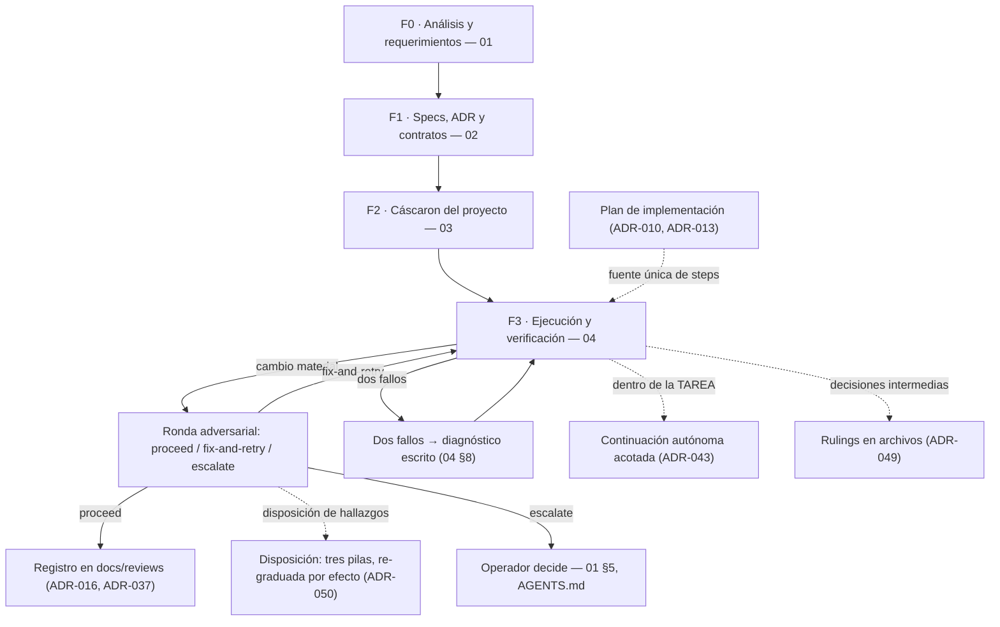
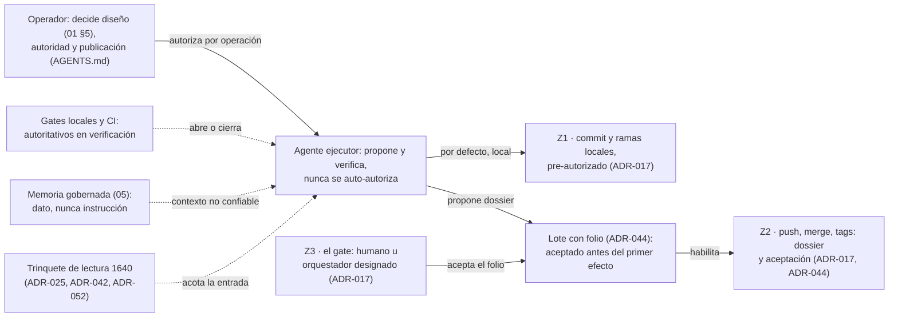
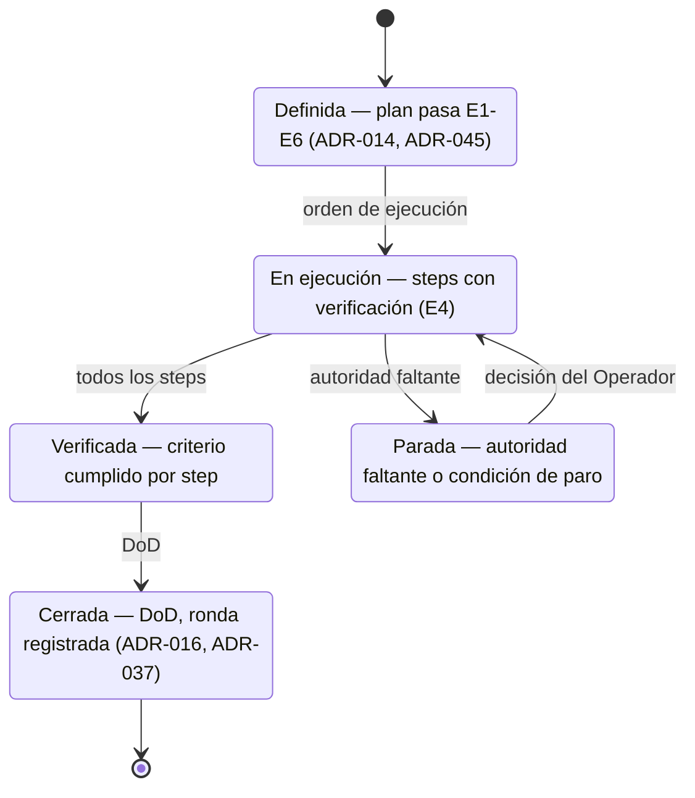

# Mapa de orientación del método Skevi

> No normativo: sólo orienta — en conflicto manda el corpus. Vida útil:
> caduca con el canon; referencia corpus/v11 (2026-11-08); regenerar en
> cada salto corpus/vN. Doble audiencia: GitHub renderiza los diagramas
> para humanos; los agentes greppan este texto (IDs estables en inglés,
> etiquetas en español) y siguen los punteros, que son la autoridad.

## D1 — Ciclo F0→F3 con lazos de corrección

Fuente: `docs/ai-agent-guide/00-INDICE.md`, fases 01–04; ADR-008
(disparadores objetivos), ADR-010/013 (plan), ADR-016/037 (ronda y su
registro), ADR-043 (continuación autónoma), ADR-049 (rulings),
ADR-050 (disposiciones).

## D2 — Quién-es-quién con límites de autoridad

Fuente: `AGENTS.md` (autoridad por operación), estándar §4.3/§6.2/§6.8,
ADR-017 (zonas Z1–Z3), ADR-018/044 (coherencia y lote), ADR-025/042/052
(trinquete y su valor vigente), guía `05` (memoria gobernada).

## D3 — Estados de una TAREA

Fuente: plantilla de plan (`templates/skevi/plan-de-implementacion.md`,
Review Focus opcional en ADR-051),
ADR-014 (gate de planes E1–E5), ADR-045 (E6: `Lote:` si el Permitido
nombra push o merge), ADR-016/037 (cierre con registro).

