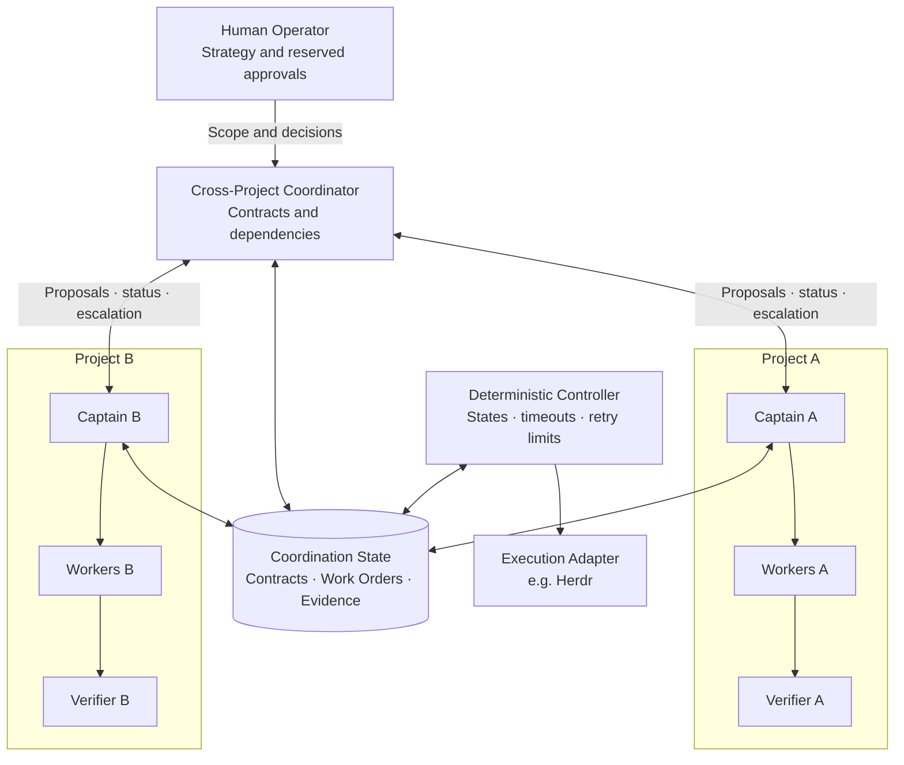
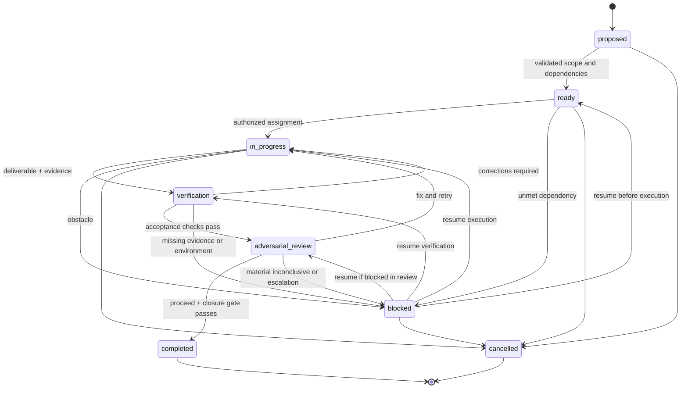
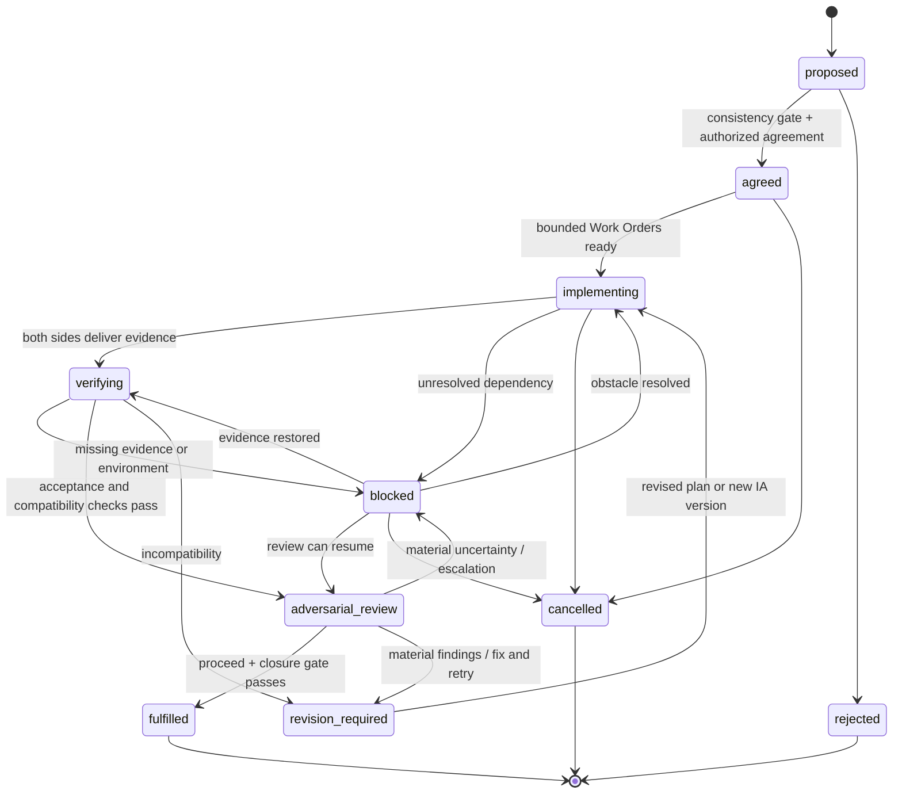
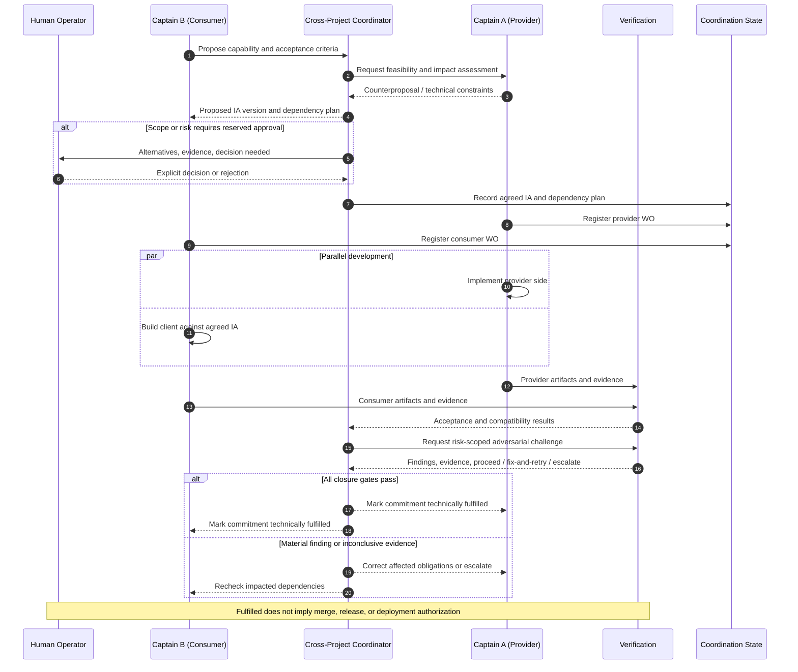
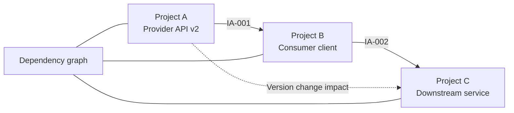
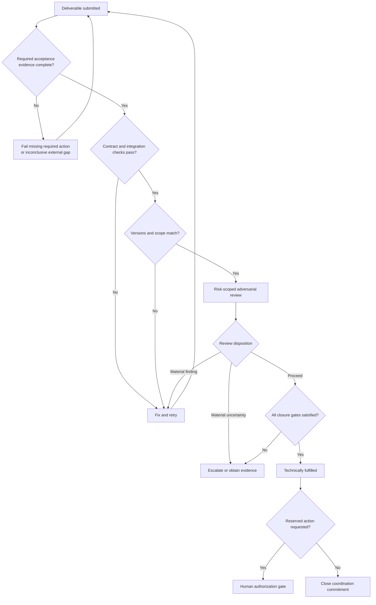

# PROP-014 — Contrato de coordinación multi-proyecto

**Estado: PROPUESTO — deliberación abierta; nada de este documento es
norma vigente ni autoriza operación alguna.** Fecha: 2026-11-08;
última modificación: 2026-11-09 (0.3.1).

Origen: texto del Operador (contrato v0.2.0, PROPOSED). Este archivo lleva la
cadena completa de candidaturas: **v0.2.1** (dos enmiendas ordenadas el
2026-11-08 — Rule A4 de subordinación al canon local y cláusula de causa
en AR5 — más las correcciones de su ronda fresca), **v0.3.0** (paquete
afinado por la ronda del 2026-11-09: Rule A5, AR2 inspeccionable, §7.2,
E3, L3/L4, §8, tres planos, renuncia acotada) y **v0.3.1** (parches
quirúrgicos de la tercera ronda: L5 concurrencia, cuatro escenarios de
falsación, designación del Coordinator, procedencia documental y
precedencia de los diagramas). Todo cambio contra la v0.2.0 está
declarado en §12; cada ronda tiene registro con hash en `docs/reviews/`.

Posición de Skevi frente al contrato (deliberación, no adopción): es
**política de ecosistema**, no canon de Skevi — cubre coordinación entre
repositorios, un plano que Skevi no ofrece (sus gates son per-repo).
Ojo al solapamiento anotado: `project-manifest.yaml` cede «contrato de
tarea ejecutable ni máquina de estados de auditoría» a epistates, y §4
y §8 de este contrato rozan ese plano cedido — punto de deliberación
abierto. Si el Operador lo aprueba, Skevi adoptaría a lo sumo un
puntero condicional (patrón ADR-019), y el adaptador de ejecución
(Herdr) viviría en `docs/orchestration/` como los adaptadores por host,
fechado y caduco. En conflicto dentro de un proyecto, manda su canon
local — es la enmienda 1.

## Preguntas abiertas que esta propuesta NO decide

1. **Hogar canónico del estado de coordinación** (CC/WO/IA/evidencia):
   ¿repo dedicado con su propio skevi, o directorio canónico versionado
   en un proyecto anfitrión? §8 lo exige pero no lo nombra.
2. **Piloto §9**: qué dos proyectos participan y qué IA los une.
3. **Aprobación**: el checklist §10 exige aprobación explícita del
   Operador; esta propuesta no la constituye.
4. **Designación del Cross-Project Coordinator** (hallazgo M5 de la
   ronda): **cerrada por 0.3.1** — el CC registra
   `coordinator_designation` con `authorization_ref` a la aprobación §10
   y el Deterministic Controller la valida en `proposed → agreed`.
5. **Feedback 0.2.2 para el Operador** (hallazgos H2/L2/L3 de la ronda,
   heredados de v0.2.0): **resueltos por las correcciones 0.3.0** —
   Rules L3/L4 y la etiqueta de reanudación guardada cierran el path
   que se saltaba `verification`; la colaboración gana
   `verifying → blocked`; el diagrama de secuencia registra en el
   estado de coordinación y los WOs los registran los capitanes.

## Backlog 0.3.0 — afinado por ronda del 2026-11-09 (ATERRIZADO)

Ronda fresca con mandato de refutar sobre las once propuestas
candidatas (registro: `2026-11-09-prop014-afinado-ronda.md`). Veredictos:
**desechadas** P1 (modalidad local: fail-open autocalificado; A2+A4 ya
son la modalidad local y el piso §7.1 es innegociable) y P6 (escalera de
negociación redundante con §6/§5; sobrevive sólo el presupuesto de
negociación, ahora Rule E3); **postergadas** P3 (transiciones
condicionales: hasta decidir el hogar del estado y existir más de un
escritor) y P10 (métricas de valor: al plan del piloto, con
pre-registro de baseline y definiciones a prueba de cancelar-todo /
rubber-stamp / defect-seeding); **afinadas y aterrizadas en el texto
0.3.0** P2 (Rule A5), P4 (AR2 + ejemplo), P5 (§7.2), P7 (L3/L4 +
diagramas), P8 (§8), P9 (§2) y P11 (§11). La redacción 0.3.0 está
cubierta por la renuncia acotada de P11: correcciones enumeradas, sin
nueva ronda general; el piloto falsifica.

---

# Multi-Project Agent Coordination Contract

**Status:** PROPOSED  
**Version:** 0.3.1  
**Scope:** Coordination of autonomous agent teams working within and across software projects  
**Implementation:** Technology-neutral; Herdr may be used as an execution adapter  
**Authority:** This document proposes a protocol. It does **not** grant permissions or authorize repository changes, commits, merges, releases, deployments, or persistent governance writes.

## 1. Purpose and non-goals

Enable multiple projects to develop independently while negotiating dependencies, producing compatible deliverables, and verifying cross-project commitments with minimal operator intervention.

**In scope:** role authority, task and contract lifecycles, escalation, acceptance verification, risk-proportionate adversarial review, dependency tracking, traceability, and recovery rules.

**Out of scope (deferred):** operator-advisor agent, speech interface, autonomous release approvals, vendor-specific orchestration, and an organization-wide memory architecture.

## 2. Architecture

A **Project Captain** governs work within an explicitly delegated project scope. A **Cross-Project Coordinator** handles relationships between projects but does not become their superior authority. **Workers** implement bounded work orders. **Verifiers** check evidence against acceptance criteria and conduct risk-proportionate adversarial challenges. A **Deterministic Controller** tracks state, retries, deadlines, and authorized transitions. The **Human Operator** retains strategic authority and reserved approvals.

These are **roles**, not mandatory separate LLM processes. One runtime may implement multiple compatible roles where independence is not claimed. Verification performed by another agent is functionally separate, not automatically independent audit.

Deliberation (agents, captains, coordinator) is probabilistic; control (authorization checks and transition validation) is deterministic controller logic; evidence is a verifiable record. Permission and transition validity must never depend exclusively on probabilistic reasoning: a deliberative actor may propose, never self-certify, a control decision. This constrains control decisions only — adversarial review (§7.1) remains deliberative by design, with its outputs recorded as AR5/AR6 evidence.



### Authority boundaries

| Role | May do within approved scope | Must not do without separate authorization |
|---|---|---|
| Human Operator | Set objectives, delegate scope, approve material risks and reserved actions | N/A; actions remain subject to platform and organizational controls |
| Project Captain | Decompose and supervise project work, assign workers, request verification, recommend integration | Change another project's resources or expand its own authority |
| Cross-Project Coordinator | Register dependencies, facilitate proposals, detect conflicts, recommend resolution, escalate | Unilaterally impose interface changes or authorize deployments |
| Worker | Implement and test a bounded Work Order, propose changes | Expand scope, access secrets outside scope, commit/push/merge/deploy without authorization |
| Verifier | Independently *check artifacts and evidence* where technically feasible; report pass/fail/inconclusive | Assert independent audit or approve reserved actions |
| Deterministic Controller | Enforce transitions, retry limits, idempotency keys, and stop conditions | Interpret new policy or silently bypass safety prompts |

**Rule A1 — Default deny:** No role can infer authorization from a task description, another agent's request, a status value, or this contract. Execution permissions must be explicitly delegated and enforced where technically possible.

**Rule A2 — Project sovereignty:** A project's captain controls its internal work within delegated scope. Cross-project coordination is an agreement process, not implicit write access.

**Rule A3 — Human-reserved actions:** Scope expansion, material risk acceptance, production promotion, and any commit, push, merge, tag, release, deployment, publication, or governed-memory write require explicit authorization covering those actions. An agreed interface does not authorize its integration or release.

**Rule A4 — Local canon precedence (enmienda 1):** Within any participating project, authority, evidence, and verification obligations are governed by that project's own adopted canon (for example, its skevi-gate and standard). This contract governs only cross-project coordination. Rules A1–A3 and §7.1 are a minimum floor within every participating project: a local canon may add obligations, never subtract from them, and "stricter" is computed against this contract as the baseline. A WO/CC/IA cannot grant, inside a project, what that project's canon denies, and no local canon can authorize, inside a project, what Rules A1–A3 reserve. For checks that feed a shared IA or CC, each participant applies its own canon to its own obligations, and the shared check passes only if it satisfies every applicable canon; a canon-versus-canon conflict escalates per §6 to the Human Operator, never to the Coordinator. «Strictest-of-all» presupposes that a satisfying option exists: where two canons impose contradictory treatments of the same evidence and no option satisfies both, the shared check cannot pass — the affected operation remains blocked until the conflict is resolved per §6. The rule is not a general solver for incompatible canons (0.3.1). The classification of a check as local or cross-project is recorded by the Verifier and is disputable via §6.

**Rule A5 — Effective authorization (0.3.0):** Every effectful operation is checked against its effective authorization before execution; if authorization cannot be verified, the operation is denied. A WO or CC records an `authorization_ref` binding to the delegating mechanism: reserved actions of Rule A3 record the human acceptance; a captain's scope records the CC `authority` block; inside a participating project, the project's local canon governs the form of delegation (Rule A4) and the `authorization_ref` may point to that mechanism's own artifact. Authorization is evaluated against the current state of the delegating mechanism at each effectful transition — a recorded reference is never a cache of permissions: if the underlying authorization was revoked, expired, or superseded, the operation is denied and any in-flight step stops per Rule E2. The Coordinator's own authority binds to the operator approval of §10; no role self-issues authorization. A CC MUST record the designation of its Cross-Project Coordinator and the scope of that designation (0.3.1), carrying an `authorization_ref` to the §10 approval; the Deterministic Controller validates the designation on the `proposed → agreed` transition, and an agent not so designated does not exercise Coordinator authority. An Execution Authorization Envelope (resources, paths, operations, constraints, expiry, revocation) may serve as an illustration and MUST NOT introduce a second delegation format inside a project whose canon already defines one.

## 3. Minimal coordination objects

Three distinct objects share `id`, `version`, `owner`, `status`, `references`, and audit timestamps. Keep payloads small; store authoritative artifacts by stable references, not copied summaries.

| Object | Purpose | Minimum required fields |
|---|---|---|
| **Coordination Contract (CC)** | Who may coordinate, change, accept, or escalate a particular collaboration | `id`, `version`, `participants`, `scope`, `authority`, `coordinator_designation`, `escalation_policy`, `verification_policy`, `status` |
| **Work Order (WO)** | Bounded unit of executable work | `id`, `project`, `owner`, `objective`, `allowed_scope`, `excluded_scope`, `dependencies`, `acceptance`, `permissions`, `authorization_ref`, `status` |
| **Interface Agreement (IA)** | Observable technical commitments between provider and consumer projects | `id`, `version`, `provider`, `consumer`, `interface_reference`, `compatibility_policy`, `acceptance_tests`, `status` |

An IA may have multiple consumers, but each consumer's approval and verification status must remain separately identifiable. A WO references the CC/IA it implements; no duplicated policy text is needed.

### Illustrative contract (not an authorization token)

```yaml
coordination_contract:
  id: CC-001
  version: "0.1.0"
  status: proposed
  participants:
    provider_project: project-a
    consumer_project: project-b
  scope:
    objective: "Deliver compatible memory retrieval interface"
    references:
      interface_agreement: IA-001
      work_orders: [WO-A-001, WO-B-001]
  authority:
    project_captains: [propose, plan_within_scope, verify]
    cross_project_coordinator: [track, recommend, escalate]
    human_reserved: [approve_scope_expansion, accept_material_risk, authorize_release]
    coordinator_designation:
      agent_ref: <designated-agent>
      scope: "IA registration and dependency tracking for CC-001"
      authorization_ref: <operator-approval-per-section-10>
  escalation_policy:
    unresolved_contract_conflict: human_operator
    unauthorized_action: stop
    newly_discovered_material_risk: stop_and_escalate
  verification_policy:
    required: [provider_contract_tests, consumer_contract_tests, integration_tests]
    evidence: [artifact_versions, commands, exit_codes, environment, findings]
    status_on_missing_evidence: inconclusive
    adversarial_review: risk_proportionate
    review_decisions: [proceed, fix_and_retry, escalate]
```

## 4. Lifecycle and transitions

**Work Order states:** `proposed -> ready -> in_progress -> verification -> adversarial_review -> completed`. A work order may enter `blocked` from `ready`, `in_progress`, or `verification`, and resume to a previously recorded executable state after its blocker is resolved. `cancelled` is terminal. `completed` means required acceptance checks and adversarial gates have passed for the specific reviewed version; it does **not** authorize release or merge.

**Collaboration states:** `proposed -> agreed -> implementing -> verifying -> adversarial_review -> fulfilled`. `blocked` and `revision_required` are recoverable; `rejected` and `cancelled` are terminal. `agreed` requires a bounded pre-agreement consistency challenge (authority, conflicting requirements, feasibility, testability, dependency cycles), recorded acceptance by each designated project representative, and any human approval required by scope; agent assent alone does not create new authority. An interface change creates a **new IA version** and triggers impact review; do not silently mutate an agreed version.





**Rule L1 — Status separation:** Runtime states (e.g. Herdr `blocked` or `done`) are observations, not canonical Work Order states or proof of success. Map runtime events to candidate transitions only after checking task evidence and policy.

**Rule L2 — Terminal and retry control:** Do not automatically repeat side-effecting actions if their prior outcome is unknown. Inspect the authoritative system first; resume using an idempotency key when supported or escalate.

**Rule L3 — Ownership of registration (0.3.0):** Only a project's captain (or delegated owner) creates or modifies that project's Work Orders; the Coordinator records agreements and dependencies in the coordination state, never inside a project.

**Rule L4 — Resume from blocked (0.3.0):** Resumption from `blocked` returns to the executable state recorded when the Work Order or collaboration entered `blocked`; a Work Order blocked before entering review cannot resume into `adversarial_review` — entering review requires passing `verification`.

**Rule L5 — Concurrent transitions (0.3.1):** A state transition MUST NOT overwrite or silently supersede a conflicting concurrent transition. The Deterministic Controller arbitrates: a transition commits only against the object's current `prior_state` (compare-and-set, §8), and a rejected transition is itself recorded as a §8 event for reconciliation. L5 complements §8's duplicate-transition prevention — a duplicate is a replay of the same event; a conflict is a race between distinct events. Reconciliation runs under the negotiation budget of E3 and §6; the concrete storage mechanism is decided together with the canonical state home.

The diagrams of §4, §5 and §7 are illustrative representations: they are not authorizations and do not replace the normative transition conditions (Rules L1–L5). Where a diagram and a rule diverge, the rule prevails.

## 5. Cross-project protocol



**Rule P1 — Propose before crossing boundaries:** A consumer asks for an external capability through an IA proposal; it does not dispatch workers into another project's resources.

**Rule P2 — Concurrency:** Projects may work in parallel against an agreed, versioned interface, using mocks or contract fixtures. Shared-file ownership and integration sequencing must be explicit.

**Rule P3 — Dependency graph:** Store directed edges `consumer WO -> required provider artifact/version`. Detect cycles, missing providers, incompatible versions, and transitive impact before advancing dependent work. A cycle MUST be resolved or expressly modeled as an iterative delivery plan with bounded phases and testable intermediary contracts; a plain cyclic dependency MUST NOT be considered ready.



## 6. Escalation and stop policy

| Condition | First handler | Required behavior |
|---|---|---|
| Local recoverable failure | Worker, then Project Captain | Retry within bounded budget; record attempts |
| Repeated failure or conflicting local priorities | Project Captain | Replan within scope or escalate |
| Cross-project interface conflict | Cross-Project Coordinator | Compare options and impacts; request agreement |
| Contract conflict unresolved or authority insufficient | Human Operator | Present alternatives and consequences; do not presume approval |
| Unknown side-effect outcome, unapproved boundary crossing, material new risk | Controller + responsible Captain | Stop affected action; preserve evidence; escalate when necessary |
| Independent task unaffected by blocked action | Owning Project Captain | Continue if within scope and safe |

**Rule E1:** A `blocked` runtime indication is not automatically a human escalation. Classify its cause and required authority first. Never automatically approve security, permission, or trust prompts.

**Rule E2:** If an operation exceeds authorization or introduces material new risk, stop that operation; unrelated permitted work may continue.

**Rule E3 — Negotiation budget (0.3.0):** Cross-project negotiations carry a predeclared budget (rounds or time). On exhaustion without agreement, the conflict escalates per §6. Rule AR4 bounds review effort, not negotiation.

## 7. Verification and evidence

A commitment is `fulfilled` only when its agreed acceptance criteria **and required adversarial review** have evidence linked to **specific versions and environments**, with no unresolved material blockers or uncertainty. At minimum record:

- exact artifact/repository references and revisions;
- acceptance criteria and which test checks each criterion;
- test commands or procedures, timestamps, environment, exit codes, and results;
- incompatibilities, assumptions, untested cases, and open risks;
- identities of implementer, verifier, and approving authority where applicable.

A claim of success by a worker is **not** verification. A SHA alone proves neither deployment nor acceptance. Agent-based review is self/peer review unless operational and organizational independence is actually demonstrated. For negative security or isolation tests, include a positive control to show the probe operates.



### 7.1. Risk-proportionate adversarial review

**Rule AR0 — Pre-agreement challenge.** Before a material CC or IA enters `agreed`, challenge its authority assumptions, requirement consistency, testability, feasibility, and dependency graph. Record the result with the contract version. This does not duplicate the later implementation review.

**Rule AR1 — Falsification, not endorsement.** Required adversarial review MUST actively seek counterexamples to the claimed result, including untested assumptions, unauthorized changes, false provenance, regressions, and cross-project incompatibilities outside the original acceptance criteria. A reviewer MUST NOT treat a positive summary as sufficient evidence. A round that merely repeats acceptance checks or praises the work does not count as adversarial review.

**Rule AR2 — First broad, then narrower.** For a material change, the **first** adversarial round MUST inspect the affected contract boundary, authority, evidence provenance, key failure modes, and transitive dependency impact. Each **subsequent** round SHOULD focus on unresolved findings, applied fixes, directly affected checks, and plausible regressions introduced by those fixes. Unaffected verified checks MAY be referenced rather than rerun. The reviewer MUST record the scope and reason for narrowing. Avoid repeatedly reopening previously resolved issues without new evidence. Evidence reuse in a later round requires a recorded, inspectable impact basis for the reused required check — diff evidence, dependency analysis, or a selective re-test; a reviewer's declaration that nothing relevant changed is a hypothesis, not a basis. On material uncertainty about whether a reused check still applies to the reviewed version, rerun the affected check.

**Rule AR3 — Reopen only on meaningful impact.** A materially changed artifact, contract version, threat assumption, dependency, or newly discovered high-severity risk MUST trigger an impact assessment. Expand the next round only to the changed or plausibly affected areas; restart broad review only if the original assumptions or trust boundaries no longer hold. Narrowing MUST NOT conceal new material risk.

**Rule AR4 — Bounded cost and termination.** Review MUST use predeclared proportional budgets (such as time, attempts, or token/cost ceiling). On budget exhaustion with unresolved material findings or uncertainty, the decision is `escalate`, **not** `proceed`. The default decision set for each round is exactly `proceed | fix-and-retry | escalate`. No unbounded self-review loops are allowed.

**Rule AR5 — Evidence and polarity.** Each required check MUST record a stable ID, claim, reviewed artifact version, result (`pass | fail | inconclusive`), and evidence reference or explicit missing-evidence reason. The aggregate MUST NOT report `pass` if a required material check is `fail` or `inconclusive`. An omitted required check is a **failed evidence obligation**; an external inability to determine a result is `inconclusive`. If cause is uncertain, record `inconclusive` and do not close; do not assume fault. Any material `inconclusive` blocks fulfillment. A failing test is not reclassified as inconclusive merely because no fix is available. Where a participating project's local canon imposes a stricter cause-attribution rule — for example, an impediment caused by the executor itself counts as `fail`, not `inconclusive` — that stricter rule governs that project's checks (Rule A4); this section's no-fault-assumption applies only to genuinely uncertain causes external to the executor. «Executor» means the worker/runtime executing the Work Order under review. Cause attribution is a recorded field of each check (`executor-caused | external-uncertain`, with its basis), classified by the Verifier; a disputed attribution escalates per §6.

**Rule AR6 — Findings.** Each finding MUST include ID, severity, affected claim/contract and versions, concrete counterexample or evidence, corrective action, and status (`open | resolved | accepted_by_authority` when applicable). Unresolved BLOCKER/HIGH findings MUST block technical fulfillment. Agents MUST NOT reduce severity or accept material risk solely to close the gate. The human may make a separately documented risk decision within actual authority; that decision does not retroactively turn a failed check into `pass` or imply technical fulfillment.

**Rule AR7 — Cross-project obligations.** Review the provider and consumer versions together; check version compatibility, agreed interfaces, dependent Work Orders, transitive effects, and whether each designated party has supplied its verification evidence. Passing local project tests alone cannot fulfill an interproject agreement.

**Rule AR8 — Review provenance.** Record implementer, reviewer/process, role separation, evidence origin, commands/results/environment where relevant, reviewed versions, findings, limits, and final disposition. Another LLM does not automatically constitute independent audit. Optional reproducible hashes can bind recorded bytes but do not prove execution, truth, approval, or independence.

**Rule AR9 — Closure.** `completed` or `fulfilled` requires: (a) required acceptance checks `pass`; (b) required adversarial review disposition `proceed`; (c) no unresolved material `fail`, `inconclusive`, BLOCKER, or HIGH; (d) impacted cross-project checks pass; and (e) all applicable authority gates are satisfied. Closure is version-specific; it does not grant commit, merge, publication, or deployment permissions.

### 7.2. Proportionality defaults (0.3.0)

`risk_proportionate` defaults to three tiers, classified by impact and exposure — never by diff size — recorded by the Verifier with its reason, and disputable via §6:

- **Low** — changes with no executable effect and no binding on executors (typo-level prose, comments): consistency and affected-reference checks. Documents that bind executors (instruction files, gate configuration, contracts) are never Low.
- **Medium** — new functionality or internal behavior change: a first broad round over affected behavior (Rule AR2), then narrowed rounds.
- **High** — authority, security, shared contracts (CC/IA), or data integrity: boundary review, positive and negative controls (§7), compatibility checks, and reinforced evidence.

These tiers are a baseline: a participating project's local canon may raise, never lower, them (Rule A4).

#### Review-round record (illustrative)

```yaml
review:
  id: AR-IA-001-R2
  contract_ref: IA-001@2
  round: 2
  scope:
    unresolved_findings: [F-017]
    changed_artifacts: [provider-api@rev-b]
    regression_targets: [consumer-client@rev-c]
    reused_checks:
      - id: CHECK-001
        previous_evidence_ref: evidence/check-001-r1.json
        verified_versions: [provider-api@rev-a]
        impact_analysis_ref: evidence/impact-001.json
        reuse_basis: "IMPACT-001: checked behavior, dependencies and assumptions unchanged between rev-a and rev-b (diff evidence)"
    narrowing_reason: "Only F-017 and directly affected dependencies remain"
  checks:
    - id: CHECK-017
      claim: "Provider and consumer agree on pagination semantics"
      result: pass
      artifact_versions: [provider-api@rev-b, consumer-client@rev-c]
      evidence_ref: evidence/check-017.json
  findings:
    - id: F-017
      severity: high
      status: resolved
      evidence_ref: evidence/f-017-resolution.json
  disposition: proceed
  review_independence: functional_separation_only
```

A `proceed` in an individual review round does not close the contract if another required gate remains open. Review records are version-bound and must not be reused after a change that invalidates their assumptions.

## 8. Persistence, recovery, and observability

Maintain a canonical record independent of execution sessions. Every state transition should include `event_id`, `object_id`, `prior_state`, `next_state`, `actor`, `reason`, `timestamp`, and evidence/authorization references. Prevent duplicate transitions and support audit replay. Logs and records must minimize secret and personal-data exposure.

At recovery, reconcile unfinished Work Orders against the actual repository, CI, and external systems before reissuing commands. Treat unknown outcomes as `needs_reconciliation`, not automatically failed. The controller may resume only when the intended action is safe, still authorized, and idempotent or demonstrably not yet executed.

**Implementation note:** Herdr can supply agent execution and observed runtime events. It is not the source of truth for contract acceptance, authority, or release state.

For multi-step cross-repository operations, reconcile each participant against its actual systems per the rules above before any retry; every step obeys L2 and A1–A3 throughout — reconciliation steps are themselves effectful operations requiring effective authorization (A5). A compensation may run only if it is pre-defined in the CC and authorized; improvised compensations are not permitted. If joint consistency of the collaboration cannot be established, the CC remains blocked and escalates per §6.

## 9. Minimal pilot and falsification criteria

**Pilot:** Two projects, one provider IA, one consumer IA, two project captains, workers, one verifier function, and a lightweight coordinator/controller. Do not add a permanent global LLM unless observed coordination complexity warrants it.

| Hypothesis | Test / counterexample | Evidence of success |
|---|---|---|
| Projects remain autonomous | Block Project A while B has independent work | B continues only authorized independent tasks |
| Contracts prevent silent incompatibility | Introduce a breaking interface version | Coordinator flags affected consumers and prevents false fulfillment |
| Runtime completion is not proof | Worker reports done without test evidence | WO remains unverified/inconclusive |
| Recovery avoids duplicates | Restart after an action with unknown result | No blind replay; reconciliation is logged |
| Authority remains bounded | Request out-of-scope write or release | Affected action stops; valid in-scope positive control still works |
| Revocation binds mid-flight (0.3.1) | Revoke an authorization while its WO step is pending | In-flight step stops (E2/A5); no permission cache outlives revocation; a non-revoked in-scope step proceeds |
| Unsupported evidence reuse rejected (0.3.1) | Reuse a required check with a naked «no change» basis over a changed artifact | Reuse rejected or check rerun; no closure on stale evidence; a reuse with recorded impact basis is accepted |
| Resume cannot skip verification (0.3.1) | Block a WO before review, then attempt to resume into `adversarial_review` | Resume returns to the recorded pre-block state (L4); review entry still requires `verification`; a WO blocked in review resumes to `adversarial_review` |
| Conflicting transitions land safely (0.3.1) | Two actors commit conflicting transitions on the same object | Only one transition lands; the other is rejected and reconciled (L5) |
| False Coordinator designation rejected (0.3.1) | An agent self-designates as Coordinator without §10-linked authorization | The `proposed → agreed` transition is denied by the Controller; a properly designated positive control proceeds |

**Pilot exit criteria:** All ten scenarios observed with reproducible records, plus an adversarial first round and a focused second round after a seeded defect is fixed; unresolved failures and limitations reported explicitly. This is a local architecture test, not a general safety certification.

## 10. Adoption checklist

- [ ] Operator approves this contract as project policy (proposal alone is not approval).
- [ ] Identify projects, owners, delegated authorities, and excluded resources.
- [ ] Register a CC and versioned IA for the pilot dependency.
- [ ] Create bounded WOs with testable acceptance criteria.
- [ ] Implement controller checks and durable state without bypassing existing controls.
- [ ] Conduct an adversarial first round, then focused rechecks that shrink to surviving issues unless impact warrants expansion.
- [ ] Run the pilot, inspect the actual evidence, and revise this specification.

**Decision pending:** Approval of the contract and any separate implementation actions. No repository, persistent memory, CI, or production resource is changed by this document.

## 11. Self-adversarial review of this specification (0.2.0, amended)

**Review type:** Author self-review of the text of this contract, **not independent audit**. **Evidence:** inspection of this Markdown specification and its internal consistency; no running agent fleet, cross-project protocol, policy enforcement, or end-to-end workflow was exercised. The checks below are design-level only. Findings were challenged against the revised text; their disposition does not certify implementation.

| ID | Counterexample / failure hypothesis | Corrective rule | Design-level disposition |
|---|---|---|---|
| SR-01 | A contract may be agreed with contradictory obligations, even though delivery later passes an acceptance gate. | AR0 adds pre-agreement consistency challenge; `agreed` transition is guarded. | Addressed in text; behavior untested |
| SR-02 | A second review could reuse a green check from an obsolete artifact or assumption. | AR2/AR3 require impact assessment; review example records referenced versions and reuse basis. | Addressed in text; evidence-reuse enforcement untested |
| SR-03 | An agent could narrow review until a newly introduced material regression is ignored. | AR3 requires impact-based expansion; material changed trust boundaries require broad re-review. | Addressed in text; detection coverage untested |
| SR-04 | An agent could exhaust review budget and declare success or loop indefinitely. | AR4 makes budget exhaustion with material uncertainty an escalation, not a pass. | Addressed in text; budget enforcement untested |
| SR-05 | Both projects can pass local checks while an incompatible version breaks their shared agreement. | AR7 requires joint versioned, transitive cross-project checks. | Addressed in text; integration untested |
| SR-06 | A cyclic dependency could be marked ready without any deliverable becoming available. | P3 requires cycle resolution or bounded iterative milestones before readiness. | Addressed in text; graph detection untested |
| SR-07 | A human risk acceptance could be misrepresented as proof that a failed technical check passed. | AR6 and AR9 preserve failed evidence and distinguish risk decisions from fulfillment. | Addressed in text; policy enforcement untested |
| SR-08 | A local canon looser than this contract could displace Rules A1–A3 inside that project. | A4 (0.2.1) sets A1–A3 and §7.1 as a minimum floor, computes "stricter" against this contract as baseline, and routes canon-versus-canon conflicts to the Human Operator. | Addressed in text; behavior untested |

**Residual material limitations:** The contract does not implement authentication, authorization enforcement, reviewer isolation, provenance attestation, a state machine, dependency analysis, or proof that review probes actually ran. A separate implementation must test both negative and positive controls. Review cannot establish the absence of undiscovered defects. The normative rules still need validation against a real pilot before adoption. The SR table above is the 0.2.0 author self-review; later amendments were reviewed externally as follows, with no independence claimed beyond fresh-context separation: 0.2.1 — fresh adversarial round of 2026-11-08 (`docs/reviews/2026-11-08-prop014-contrato-ronda.md`, `report_sha256 = 8647d20d7dae2f951123af29d32eb425e90a2ba6d8393b0d21fd3a4dab3524e1`); 0.3.0 — refine-or-discard round of 2026-11-09 (`docs/reviews/2026-11-09-prop014-afinado-ronda.md`, `report_sha256 = 7337a4ea06e87b5f50b439076bfb550a03066816f295250551e726ec1610793c`); 0.3.1 — narrow delta round of 2026-11-09 (`docs/reviews/2026-11-09-prop014-031-ronda.md`). The v0.2.0-era diagram/text divergences were resolved by the 0.3.0 corrections (Rules L3/L4, the guarded resume label, the added collaboration transition, and the sequence diagram recording into coordination state).

From 0.3.0, the contract's invariants are normative (MUST) for any implementation claiming conformance, and conformance is demonstrated by falsification tests on a real implementation (§9 style), not by further full-specification review. The waiver of full-spec review is bounded: it covers editorial changes, the enumerated 0.3.0 corrections, and pilot parameterization. Any change to Rules A1–A5, AR0–AR9, or the state semantics of §4 reopens review of the affected section before the pilot.

## 12. Change history

- **0.2.0 (proposed):** Added falsification-oriented, evidence-granular, progressively narrowed adversarial review; amended terminal state gates, diagrams, and pilot criteria. No implementation or authorization implied.
- **0.2.1 (proposed):** Per the Operator's directive of 2026-11-08 and the fresh adversarial round of the same date: added Rule A4 (local canon precedence) with Rules A1–A3 and §7.1 as minimum floor, shared-check strictest-of-all rule and §6 escalation for canon conflicts; added the stricter-local-cause clause of AR5 with the definition of «executor» and recorded cause attribution classified by the Verifier; added SR-08 and the external-review note to §11; updated the Version header. v0.2.0-inherited text is otherwise unchanged. No implementation or authorization implied.
- **0.3.0 (proposed):** Per the refined adversarial round of 2026-11-09 (afinar/desechar): Rule A5 — effective authorization with `authorization_ref`, evaluation against the delegating mechanism's current state (no permission caching), revocation/expiry handling, Coordinator bootstrap bound to §10 approval, and the envelope demoted to illustration; evidence reuse in AR2 now requires a recorded, inspectable impact basis, and the §7.1 example models it; new §7.2 proportionality defaults (baseline tiers, raisable by local canon; executor-binding documents never Low); Rule E3 negotiation budget; Rules L3 (captain-only WO registration) and L4 (resume-from-blocked invariant) plus the guarded resume label, the collaboration `verifying → blocked` transition, and the sequence diagram recording into coordination state; §8 partial-failure recovery with pre-defined compensations and blocked-CC on unestablishable consistency; §2 three-planes clause; §11 normative invariants with bounded review waiver. Discarded by the round: the activable-modality proposal (fail-open) and the negotiation ladder (redundant; E3 survives it). Deferred to the pilot: conditional transitions and value metrics. No implementation or authorization implied.
- **0.3.1 (proposed):** Per the third review's surviving findings, refined by the narrow delta round of 2026-11-09: Rule L5 — concurrent transitions arbitrated by the Deterministic Controller via compare-and-set on `prior_state`, rejected transitions recorded as §8 events, reconciliation under E3/§6; five new falsification scenarios in §9 (revocation mid-flight, unsupported evidence reuse, resume-cannot-skip-verification, conflicting concurrent transitions, false Coordinator designation — each with its positive control); explicit Coordinator designation recorded in the CC (`coordinator_designation` with `authorization_ref` to §10) and validated by the Controller on `proposed → agreed`; document provenance corrected (version chain in the header, §11 retitled, exact register paths and hashes, Version bumped); diagrams of §4/§5/§7 declared illustrative with normative precedence of Rules L1–L5; A4 «strictest-of-all» clarified as presupposing satisfiability — not a general solver. No implementation or authorization implied.
